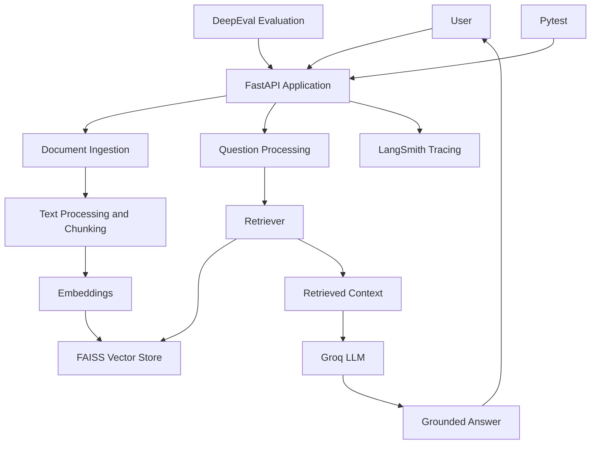
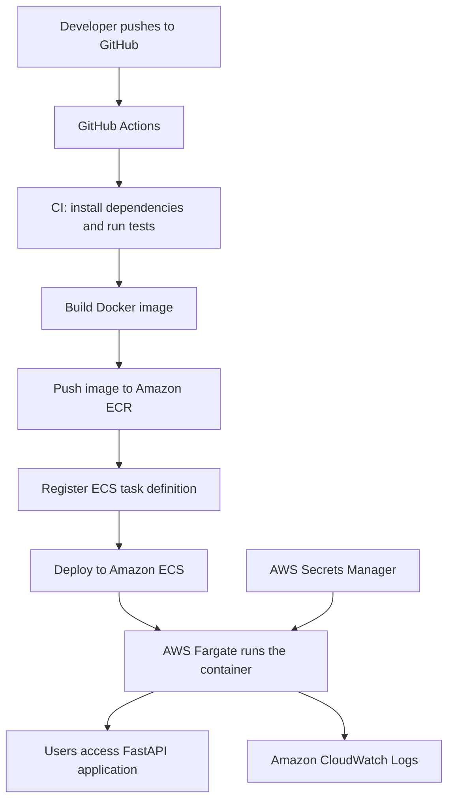

# End-to-End LLMOps Project

An end-to-end Retrieval-Augmented Generation (RAG) application with evaluation, observability, containerization, and automated deployment to AWS ECS Fargate.

[](https://www.python.org/)
[](https://fastapi.tiangolo.com/)
[](https://www.docker.com/)
[](https://aws.amazon.com/fargate/)

## Table of Contents

- [Overview](#overview)
- [Why I Built This Project](#why-i-built-this-project)
- [Architecture](#architecture)
- [Key Features](#key-features)
- [Technology Stack](#technology-stack)
- [RAG Workflow](#rag-workflow)
- [Evaluation Results](#evaluation-results)
- [Observability and Monitoring](#observability-and-monitoring)
- [Project Structure](#project-structure)
- [Run Locally](#run-locally)
- [Run with Docker](#run-with-docker)
- [AWS Deployment](#aws-deployment)
- [CI/CD Pipeline](#cicd-pipeline)
- [Security](#security)
- [Cost Considerations](#cost-considerations)
- [Current Status and Known Issue](#current-status-and-known-issue)
- [Future Improvements](#future-improvements)
- [What I Learned](#what-i-learned)
- [Interview Explanation](#interview-explanation)
- [Documentation](#documentation)

## Overview

This project demonstrates how to build and operate a production-oriented, multi-document RAG application. Users can upload documents, have their content indexed, and ask questions grounded in the retrieved document context.

The project covers more than the RAG chain. It includes automated evaluation, testing, tracing, Docker packaging, AWS infrastructure, and a GitHub Actions deployment pipeline.

## Why I Built This Project

A RAG prototype can answer questions, but a deployable application also needs ways to test answer quality, observe runtime behavior, manage secrets, package the application, and release changes reliably.

I built this project to bring those pieces together in one end-to-end LLMOps workflow.

## Architecture



### AWS deployment architecture



## Key Features

- Multi-document upload and ingestion.
- Document parsing, text processing, chunking, and indexing.
- Semantic retrieval using embeddings and FAISS.
- Retrieval-Augmented Generation using LangChain and a Groq-hosted LLM.
- Retrieval optimization experiments, including MMR and cross-encoder reranking.
- RAG quality and safety evaluation using DeepEval.
- Tracing and monitoring using LangSmith.
- API testing with Pytest.
- Docker-based application packaging.
- AWS infrastructure provisioning using CloudFormation.
- Container image storage in Amazon ECR.
- Container deployment using Amazon ECS with AWS Fargate.
- GitHub Actions CI/CD with GitHub OIDC authentication.
- Runtime configuration and secret injection using AWS Secrets Manager.
- Application logs in Amazon CloudWatch.

## Technology Stack

| Area | Technologies |
|---|---|
| Language | Python |
| API | FastAPI, Uvicorn |
| RAG framework | LangChain |
| LLM | Groq, `openai/gpt-oss-20b` |
| Embeddings | Hugging Face, `sentence-transformers/all-MiniLM-L6-v2` |
| Vector store | FAISS |
| Evaluation | DeepEval |
| Observability | LangSmith |
| Testing | Pytest |
| Containerization | Docker |
| CI/CD | GitHub Actions |
| Cloud | AWS |
| Container registry | Amazon ECR |
| Container orchestration | Amazon ECS |
| Compute | AWS Fargate |
| Infrastructure as Code | AWS CloudFormation |
| Secrets | AWS Secrets Manager |
| Logging | Amazon CloudWatch |

## RAG Workflow

1. The user uploads one or more documents through the application.
2. The ingestion pipeline extracts and processes document text.
3. The text is split into chunks.
4. An embedding model converts chunks into vectors.
5. The vectors are stored in a FAISS index.
6. The user submits a question.
7. The retriever searches for relevant document chunks.
8. The retrieved context is passed to the LLM with the question.
9. The application returns an answer based on the available context.

## Evaluation Results

The project includes separate evaluations for retrieval, generation, the complete RAG pipeline, and application behavior.

### Recorded evaluation results

| Component | Metric | Recorded result |
|---|---|---:|
| Retriever | Contextual Recall | 95% |
| Retriever | Contextual Precision | 93% |
| Generator | Faithfulness | 98% |
| Generator | Answer Relevancy | 98% |
| Full RAG pipeline | Contextual Relevancy | 90% |
| Full RAG pipeline | Faithfulness | 96% |
| Full RAG pipeline | Answer Relevancy | 94% |
| Application | Correctness | 95% |
| Application | Completeness | 76% |
| Application | Style | 84% |
| Safety evaluation | Scope adherence | 0.96 |
| Safety evaluation | PII leakage score | 0.96 |
| Safety evaluation | Toxicity evaluation | 100% passed |

A retriever optimization experiment using `BAAI/bge-base-en-v1.5` recorded 0.98 contextual recall and 0.85 contextual precision.

These are recorded project evaluation results, not a guarantee of performance on every dataset or user query. Metric interpretation depends on the metric's scoring definition.

### Automated tests

Latest recorded test run:

```text
166 passed
0 failed
10 warnings
```

Run the tests with:

```bash
uv run pytest tests/ -v
```

The warnings were recorded as deprecation warnings from dependencies.

## Observability and Monitoring

LangSmith is used to trace and inspect RAG pipeline execution.

The project dashboard is named:

`Customer_Doubt_Solver_RAG_Project`

The dashboard was configured to inspect:
- P95 latency.
- Average cost.

Experimental alert thresholds were configured for:
- Average cost greater than or equal to $7.
- Latency greater than or equal to 7 seconds.

These thresholds were used during project testing and should be reviewed before production use.

## Project Structure

The following is the intended high-level structure. Adjust file and folder names if your current repository differs.

```text
End-to-End-LLMOPs-Project/
│
├── .github/
│   └── workflows/
│       ├── ci.yml
│       └── deploy.yml
│
├── config/
├── data/
├── evaluation/
├── infra/
│   ├── cloudformation.yml
│   ├── task-definition.json
│   └── AWS_DEPLOYMENT_DOCUMENTATION.md
│
├── multi_doc_chat/
├── notebook/
├── static/
├── templates/
├── tests/
│   ├── api/
│   ├── integration/
│   ├── regression/
│   └── unit/
│
├── .dockerignore
├── .env.example
├── .gitignore
├── config.yaml
├── Dockerfile
├── main.py
├── pyproject.toml
├── requirements.txt
└── README.md
```

## Run Locally

### Prerequisites

- Python 3.12 (or the version configured by the project).
- Git.
- `uv` package manager.
- Valid provider API credentials.

### 1. Clone the repository

```bash
git clone https://github.com/i-am-tushaar/End-to-End-LLMOPs-Project.git
cd End-to-End-LLMOPs-Project
```

### 2. Create and configure environment variables

Create a local `.env` file using `.env.example` as a reference.

Example variable names:

```env
GROQ_API_KEY=your_groq_api_key
LANGCHAIN_API_KEY=your_langsmith_api_key
LANGCHAIN_TRACING_V2=true
LANGCHAIN_PROJECT=Customer_Doubt_Solver_RAG_Project
```

Use your own valid credentials. Never commit `.env` or expose API keys in source control, logs, screenshots, or documentation.

### 3. Install dependencies

```bash
uv sync --locked
```

### 4. Start the application

```bash
uv run uvicorn main:app --host 0.0.0.0 --port 8080 --reload
```

Open the API documentation:

```text
http://localhost:8080/docs
```

## Run with Docker

### 1. Build the image

```bash
docker build -t llmops-rag-app .
```

### 2. Run the container

Pass credentials through environment variables or a secure environment file. Do not bake secrets into the Docker image.

```bash
docker run -d \
  --name llmops-rag-container \
  -p 8080:8080 \
  --env-file .env \
  llmops-rag-app
```

Open:

```text
http://localhost:8080/docs
```

## AWS Deployment

The application is configured for deployment to AWS using Amazon ECR, Amazon ECS, and AWS Fargate.

### AWS resources

| Resource | Purpose |
|---|---|
| Amazon ECR | Stores the Docker image |
| Amazon ECS | Manages the application service and task |
| AWS Fargate | Runs the container without managing EC2 servers |
| VPC and public subnet | Provide network connectivity |
| Security group | Controls inbound application traffic |
| IAM roles | Grant services the permissions they need |
| AWS Secrets Manager | Stores application credentials |
| Amazon CloudWatch | Collects container logs |
| AWS CloudFormation | Creates infrastructure from a template |

### Recorded deployment configuration

| Setting | Value |
|---|---|
| AWS Region | `eu-north-1` |
| ECR repository | `llmopsrepolive` |
| ECS cluster | `llmops-live-cluster` |
| ECS service | `llmops-service` |
| ECS task family | `llmops-task` |
| Container name | `llmops-container` |
| Container port | `8080` |
| Fargate CPU | `1024` (1 vCPU) |
| Fargate memory | `4096` MiB (4 GB) |
| CloudWatch log group | `/ecs/llmopstdlive` |

The public IP assigned to a running task can change when the task is replaced. Find the current address in the ECS task's networking details.

Application endpoints:

```text
http://PUBLIC_IP:8080/
http://PUBLIC_IP:8080/docs
```

Replace `PUBLIC_IP` with the current public IPv4 address of the running task. Restrict inbound access to trusted IP addresses where possible.

For the full infrastructure setup, deployment steps, troubleshooting, and cleanup instructions, see:

[`infra/AWS_DEPLOYMENT_DOCUMENTATION.md`](infra/AWS_DEPLOYMENT_DOCUMENTATION.md)

## CI/CD Pipeline

GitHub Actions automates testing and deployment.

### CI workflow

The CI workflow runs on configured pushes and pull requests. It checks out the repository, sets up Python and `uv`, installs dependencies, and runs the test suite.

### Deployment workflow

The deployment workflow runs after the CI workflow succeeds on the configured branch. Its main steps are:

1. Authenticate to AWS using GitHub OIDC.
2. Build the Docker image.
3. Authenticate to Amazon ECR.
4. Tag and push the image to ECR.
5. Register the updated ECS task definition.
6. Deploy the new task definition to the ECS service.
7. Wait for the ECS service deployment to stabilize.

The GitHub Actions role uses IAM permissions and an OIDC trust policy. This avoids storing long-lived AWS access keys in GitHub.

## Security

- Keep `.env` out of Git.
- Commit `.env.example` with variable names and placeholder values only.
- Store production credentials in AWS Secrets Manager.
- Inject secrets into ECS tasks at runtime.
- Use IAM roles with least-privilege permissions.
- Use GitHub OIDC rather than long-lived AWS access keys for CI/CD.
- Restrict security group ingress to required ports and trusted source IPs.
- Never print API keys or access tokens in workflow logs.
- Rotate credentials if they are exposed or suspected to be compromised.

## Cost Considerations

AWS resources can incur charges while they exist or are running. In particular, a running Fargate task, public IPv4 address, ECR storage, CloudWatch logs, Secrets Manager secrets, and data transfer may contribute to cost.

To pause the application's Fargate compute, set the ECS service desired task count to `0`. This does not delete the other resources or guarantee that all AWS charges stop.

Review AWS Billing and Cost Explorer regularly. Follow the cleanup steps in the deployment documentation when you no longer need the deployment.

## Current Status and Known Issue

The recorded GitHub Actions deployment completed successfully, and the deployed FastAPI application was reachable through its Swagger documentation endpoint.

A runtime issue was also observed: Groq returned `401 Invalid API Key` when the application attempted to generate a chat answer. Document upload and indexing were working, but successful LLM inference was not confirmed at that time.

Before treating the application as fully operational, verify the Groq credential stored in AWS Secrets Manager, confirm that the ECS task definition references the correct secret, and force a new ECS deployment after updating the secret. Never share the API key itself.

## Future Improvements

- Resolve and verify the Groq authentication issue in the deployed environment.
- Add authentication and authorization for application users.
- Add HTTPS using a domain and TLS certificate.
- Add more robust document storage and lifecycle management.
- Add load testing and performance benchmarks.
- Review and tune resource sizing and AWS costs.
- Expand evaluation datasets and regression tests.
- Add deployment rollback and operational alerting.

## What I Learned

Through this project, I worked across the lifecycle of an LLM application:

- Building a multi-document RAG pipeline.
- Improving retrieval and evaluating generated answers.
- Writing automated tests and regression checks.
- Tracing application execution and monitoring latency and cost.
- Packaging an application with Docker.
- Provisioning AWS infrastructure with CloudFormation.
- Deploying containers to ECS Fargate.
- Securing GitHub Actions deployment with OIDC and IAM.
- Managing runtime secrets with AWS Secrets Manager.
- Collecting application logs with CloudWatch.

## Interview Explanation

"I built an end-to-end LLMOps project around a multi-document RAG application. Users can upload documents, which are processed, embedded, and stored in FAISS. When a user asks a question, the retriever finds relevant chunks and passes the context to a Groq-hosted LLM through LangChain.

I added DeepEval to measure retrieval quality, faithfulness, answer relevancy, and safety-related behavior. I used LangSmith for tracing and monitoring, and Pytest for automated testing.

For deployment, I containerized the application with Docker and provisioned AWS infrastructure using CloudFormation. GitHub Actions runs tests, authenticates to AWS using OIDC, pushes the Docker image to ECR, and deploys it to ECS Fargate. Secrets are stored in AWS Secrets Manager and application logs are sent to CloudWatch."

## Documentation

- [Project repository](https://github.com/i-am-tushaar/End-to-End-LLMOPs-Project)
- [AWS deployment documentation](infra/AWS_DEPLOYMENT_DOCUMENTATION.md)
