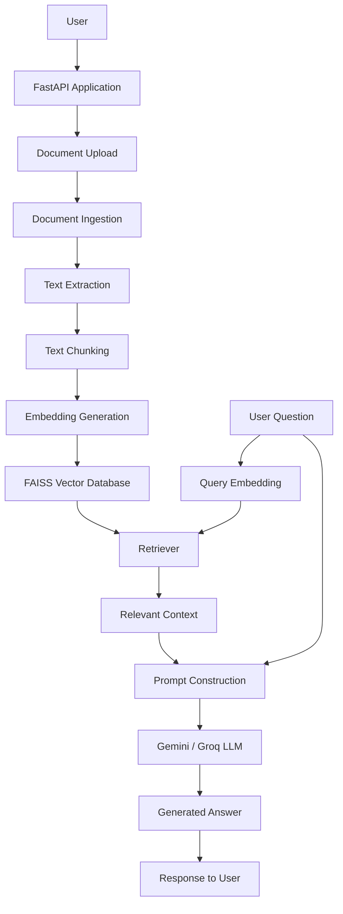
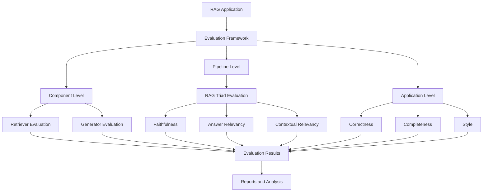
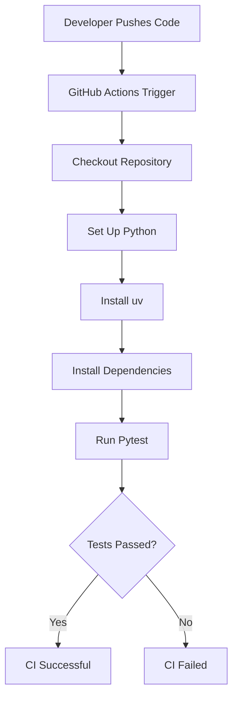

# End-to-End LLMOps Project: Multi-Document RAG Chatbot

An end-to-end Large Language Model Operations (LLMOps) project that demonstrates how to build, evaluate, test, monitor, and containerize a production-oriented Retrieval-Augmented Generation (RAG) application.

The application allows users to upload and interact with multiple documents, retrieve relevant information using semantic search, and generate context-aware answers using Large Language Models (LLMs).

The project focuses not only on building a RAG application but also on implementing the engineering practices required to make LLM-powered applications reliable, measurable, maintainable, and deployable.

---

## 1. Project Overview

Large Language Models can generate impressive responses, but they can sometimes produce inaccurate or hallucinated information. They also have limitations when answering questions about private, domain-specific, or frequently updated documents.

To address these challenges, this project implements a Multi-Document RAG Chatbot.

Instead of relying entirely on the LLM's internal knowledge, the application retrieves relevant information from uploaded documents and provides that information as context to the LLM before generating an answer.

Along with the RAG application, this project implements an LLMOps workflow covering:

- Document ingestion and processing.
- Text chunking and embedding generation.
- Vector-based document retrieval.
- Context-aware answer generation.
- Component-level, pipeline-level, and application-level evaluation.
- LLM-as-a-Judge using Groq.
- Automated testing using Pytest.
- Observability and tracing using LangSmith.
- Docker image creation and containerization.
- Continuous Integration using GitHub Actions.

## 2. Problem Statement

Traditional LLM applications often face the following challenges:

- Hallucinations and incorrect responses.
- Limited knowledge of private documents.
- Difficulty retrieving relevant information from multiple documents.
- Lack of systematic evaluation.
- No clear visibility into model performance and latency.
- Difficulty maintaining consistent application quality.
- Deployment and environment dependency issues.

This project addresses these challenges by combining RAG architecture with evaluation, observability, testing, and containerization.

## 3. Key Features

### RAG Application
- Multi-document question answering.
- Document ingestion and text extraction.
- Text splitting and chunking.
- Semantic embeddings.
- FAISS vector database.
- Context-aware answer generation.
- Gemini and Groq LLM integration.

### Evaluation Framework
- Component-level evaluation.
- Pipeline-level evaluation.
- Application-level evaluation.
- LLM-as-a-Judge using Groq.
- DeepEval-based evaluation.
- Retrieval quality measurement.
- Faithfulness and answer relevancy measurement.
- Safety, toxicity, scope, and PII leakage evaluation.
- Latency measurement and performance analysis.

### Observability
- LangSmith tracing.
- Execution monitoring.
- Latency tracking.
- Cost monitoring.
- Evaluation dashboards.
- Alert configuration.

### Engineering and Deployment
- Modular Python architecture.
- Custom logging and exception handling.
- Configuration management.
- Unit and integration testing using Pytest.
- Dependency management using uv.
- Docker image creation.
- Docker container execution.
- GitHub Actions CI workflow.

## 4. Technology Stack

| Category | Technologies |
|---|---|
| Programming Language | Python |
| API Framework | FastAPI |
| LLM Framework | LangChain |
| LLM Providers | Google Gemini, Groq |
| Embedding Models | Sentence Transformers, BGE |
| Vector Database | FAISS |
| Evaluation | DeepEval, Groq LLM Judge |
| Observability | LangSmith |
| Logging | Structlog |
| Testing | Pytest, Pytest-Cov, HTTPX |
| Dependency Management | uv |
| Containerization | Docker |
| CI | GitHub Actions |
| Document Processing | PyPDF, docx2txt |
| Version Control | Git, GitHub |

## 5. System Architecture

The project consists of two major workflows:

1. RAG Application Workflow
2. LLMOps Evaluation and Monitoring Workflow

### 5.1 RAG Application Architecture

The following diagram represents the main application workflow.



### 5.2 LLMOps Evaluation Architecture

The evaluation framework measures the quality and reliability of the RAG application at three levels.



## 6. RAG Pipeline Explanation

The RAG pipeline consists of the following stages.

### Step 1: Document Ingestion

Users upload documents through the application.

Supported document processing includes PDF and DOCX files.

### Step 2: Text Extraction

Text is extracted from uploaded documents using document-processing libraries.

### Step 3: Text Chunking

Large documents are divided into smaller chunks to improve retrieval accuracy and maintain relevant context.

The project uses configurable chunk sizes and overlap.

### Step 4: Embedding Generation

Text chunks are converted into numerical vector representations using embedding models.

The project experiments with models such as:

- sentence-transformers/all-MiniLM-L6-v2
- BAAI/bge-base-en-v1.5

### Step 5: Vector Storage

Generated embeddings are stored in the FAISS vector database.

FAISS enables efficient similarity-based document retrieval.

### Step 6: Information Retrieval

When a user asks a question, the system generates a query embedding and retrieves the most relevant document chunks.

### Step 7: Prompt Construction

The retrieved context and user question are combined into a structured prompt.

### Step 8: Answer Generation

The prompt is passed to the configured LLM, such as Google Gemini or Groq, to generate a context-aware response.

### Step 9: Response Delivery

The generated answer is returned to the user through the FastAPI application.

## 7. Evaluation Framework

A major focus of this project is evaluating the quality and reliability of the RAG application.

Instead of assuming that the application works correctly, the evaluation framework measures its performance using predefined datasets and evaluation metrics.

Evaluation is divided into three levels.

### 7.1 Component-Level Evaluation

Individual RAG components are evaluated independently.

**Retriever Evaluation**

Measures whether the retriever fetches relevant information.

Metrics:
- Contextual Recall.
- Contextual Precision.

**Generator Evaluation**

Measures the quality of generated responses.

Metrics:
- Faithfulness.
- Answer Relevancy.

### 7.2 Pipeline-Level Evaluation

Evaluates the complete RAG pipeline.

Metrics:
- Contextual Relevancy.
- Faithfulness.
- Answer Relevancy.

### 7.3 Application-Level Evaluation

Evaluates the overall application response quality.

Metrics:
- Correctness.
- Completeness.
- Style.
- Scope Adherence.
- PII Leakage.
- Toxicity.

### 7.4 LLM-as-a-Judge

The project uses a Groq-powered LLM judge to evaluate generated responses.

The judge assesses responses against evaluation criteria and produces scores and feedback.

DeepEval is used to organize and execute evaluation experiments.

### 7.5 Evaluation Results

The following results were obtained during the project's reported evaluation experiments.

| Evaluation Area | Metric | Result |
|---|---|---:|
| Retriever | Contextual Recall | 95% |
| Retriever | Contextual Precision | 93% |
| Generator | Faithfulness | 98% |
| Generator | Answer Relevancy | 98% |
| Full RAG Pipeline | Contextual Relevancy | 90% |
| Full RAG Pipeline | Faithfulness | 96% |
| Full RAG Pipeline | Answer Relevancy | 94% |
| Application | Correctness | 95% |
| Application | Completeness | 76% |
| Application | Style | 84% |
| Safety | Scope Adherence | 96% |
| Safety | Toxicity Evaluation | 100% |
| Safety | PII Leakage | 96% |

**Note:** These are experimental results from the project's evaluation runs, not guaranteed production performance. Scores depend on the evaluation dataset, model, judge, and metric configuration.

## 8. Retriever Optimization Experiments

Multiple retrieval configurations were tested to improve retrieval quality.

| Experiment | Configuration | Observation |
|---|---|---|
| Baseline | MiniLM embeddings | Initial retrieval baseline |
| Optimization 02 | Cross-Encoder Reranker | Improved document ranking |
| Optimization 03 | BAAI/bge-base-en-v1.5 | Contextual Recall: 98%, Contextual Precision: 85% |

The experiments helped compare embedding quality and retrieval performance.

The final retrieval configuration should be selected based on the evaluation results and application requirements.

## 9. Observability and Monitoring

LangSmith is used for tracing and observing LLM application execution.

It helps understand what happens during each RAG request.

Key monitoring areas:

- LLM execution traces.
- Retriever execution.
- Response latency.
- Token usage and cost.
- Average execution cost.
- Error analysis.
- Evaluation performance.

The project also includes latency evaluation using:

- Time to First Token (TTFT).
- Average latency.
- P95 latency.
- P99 latency.
- Service Level Objectives (SLOs).

LangSmith dashboards and alerts are used to monitor application performance and cost.

## 10. Testing Strategy

Pytest is used to test application components and verify application behavior.

The testing structure includes:

- Unit tests.
- Integration tests.
- Configuration tests.
- Logger tests.
- Model loader tests.
- Application-related tests.

Run all tests:

```bash
uv run pytest tests/ -v
```

Run tests with coverage:

```bash
uv run pytest tests/ --cov=. --cov-report=term-missing
```

## 11. Project Structure

The project follows a modular architecture to separate application logic, evaluation, configuration, and testing.

```text
End-to-End-LLMOPs-Project/
│
├── .github/
│   └── workflows/
│       └── ci.yml
│
├── multi_doc_chat/
│   ├── config/
│   ├── ...
│
├── evaluation/
│   ├── adapters/
│   ├── component/
│   ├── pipeline/
│   ├── application/
│   ├── judges/
│   └── ...
│
├── tests/
│   ├── unit/
│   └── ...
│
├── config/
├── data/
├── faiss_index/
│
├── main.py
├── Dockerfile
├── .dockerignore
├── .gitignore
├── .env.example
├── requirements.txt
├── requirements-dev.txt
├── pyproject.toml
├── uv.lock
└── README.md
```

**Note:** This is a representative structure. Adjust it to match the actual folders and files in your repository.

## 12. Installation and Setup

### Prerequisites

Install the following:

- Python 3.11
- Git
- Docker Desktop
- uv package manager

### Step 1: Clone the Repository

```bash
git clone YOUR_GITHUB_REPOSITORY_URL
```

Navigate to the project directory:

```bash
cd End-to-End-LLMOPs-Project
```

### Step 2: Create Virtual Environment

```bash
uv venv
```

Activate the environment on Windows:

```bash
.venv\Scripts\activate
```

### Step 3: Install Dependencies

Install production dependencies:

```bash
uv pip install -r requirements.txt
```

Install development and evaluation dependencies:

```bash
uv pip install -r requirements-dev.txt
```

### Step 4: Configure Environment Variables

Create a `.env` file from the example:

Windows:

```bash
copy .env.example .env
```

Add your actual API credentials to `.env`.

Never commit your `.env` file to GitHub.

### Step 5: Run the Application

```bash
uv run uvicorn main:app --host 0.0.0.0 --port 8080
```

Open the API documentation:

```text
http://localhost:8080/docs
```

## 13. Docker Setup

The project uses Docker to package the application and its dependencies into a portable container.

### Step 1: Build Docker Image

```bash
docker build -t llmops-project .
```

### Step 2: Run Docker Container

```bash
docker run -d -p 8080:8080 --env-file .env --name llmops-container llmops-project
```

### Step 3: Verify Running Container

```bash
docker ps
```

### Step 4: View Container Logs

```bash
docker logs llmops-container
```

### Step 5: Access Application

```text
http://localhost:8080/docs
```

### Step 6: Stop Container

```bash
docker stop llmops-container
```

Remove container:

```bash
docker rm llmops-container
```

**Note:** The Docker image includes the application dependencies. If FAISS indexes, uploaded documents, or other runtime data are stored outside the image, mount or provide those files separately.

## 14. Continuous Integration (CI)

GitHub Actions is used to automate the testing workflow.

The CI workflow is triggered when code is pushed to the main branch or when a pull request targets the main branch.

### CI Workflow



### Current CI Implementation

- GitHub Actions workflow.
- Python environment setup.
- uv dependency installation.
- Automated Pytest execution.
- Test result reporting.

Workflow file:

```text
.github/workflows/ci.yml
```

**Current Status:** Automated Continuous Integration is implemented. Docker image publishing and automated application deployment are planned extensions.

## 15. Why RAG Instead of Fine-Tuning?

RAG was selected because the primary objective is to answer questions using external documents.

Key reasons:

- External documents can be updated without retraining the LLM.
- Retrieved context helps ground answers in source information.
- It is suitable for private and domain-specific knowledge.
- It reduces the need to maintain a separately fine-tuned model for every document collection.
- It allows retrieval quality to be independently optimized and evaluated.

Fine-tuning is more appropriate when the objective is to change model behavior, style, or task-specific capabilities rather than simply provide access to changing external knowledge.

## 16. Challenges and Solutions

| Challenge | Solution |
|---|---|
| LLM hallucinations | RAG with retrieved document context |
| Poor retrieval quality | Embedding experiments and reranking |
| Inaccurate responses | Faithfulness and correctness evaluation |
| Evaluation complexity | DeepEval and Groq LLM judge |
| Prompt and data leakage | Prompt hardening and safety evaluation |
| High response latency | Latency measurement and optimization |
| Dependency conflicts | Version management and uv |
| Deployment inconsistencies | Docker containerization |
| Manual testing | Automated Pytest and GitHub Actions |

## 17. Future Improvements

Planned improvements include:

- Automated Docker image publishing.
- Continuous Deployment (CD).
- Docker Hub or GitHub Container Registry integration.
- Cloud deployment using AWS.
- Kubernetes-based orchestration.
- Prometheus and Grafana monitoring.
- Advanced retrieval optimization.
- Improved application completeness.
- Automated evaluation in CI/CD.
- Performance and scalability improvements.

## 18. Learning Outcomes

Through this project, I gained practical experience in:

- Designing and developing RAG applications.
- Working with multiple LLM providers.
- Building embedding and retrieval pipelines.
- Optimizing vector search.
- Evaluating LLM applications.
- Implementing LLM-as-a-Judge.
- Measuring hallucinations and response quality.
- Building observability and monitoring workflows.
- Writing automated tests.
- Managing Python dependencies.
- Containerizing applications using Docker.
- Implementing CI workflows using GitHub Actions.

## 19. Conclusion

This project demonstrates how to move beyond a basic LLM chatbot and build a structured LLMOps application.

It combines RAG development, systematic evaluation, observability, automated testing, dependency management, and Docker containerization into one engineering workflow.

The primary goal is to make LLM-powered applications more reliable, measurable, maintainable, and easier to deploy.

---

## Author

**Tushar Choudhary**

AI Engineer | LLMOps | RAG | Machine Learning

- GitHub: YOUR_GITHUB_PROFILE_URL
- LinkedIn: https://www.linkedin.com/in/insightsbytushar/

---

**If you find this project useful, consider giving the repository a star!**